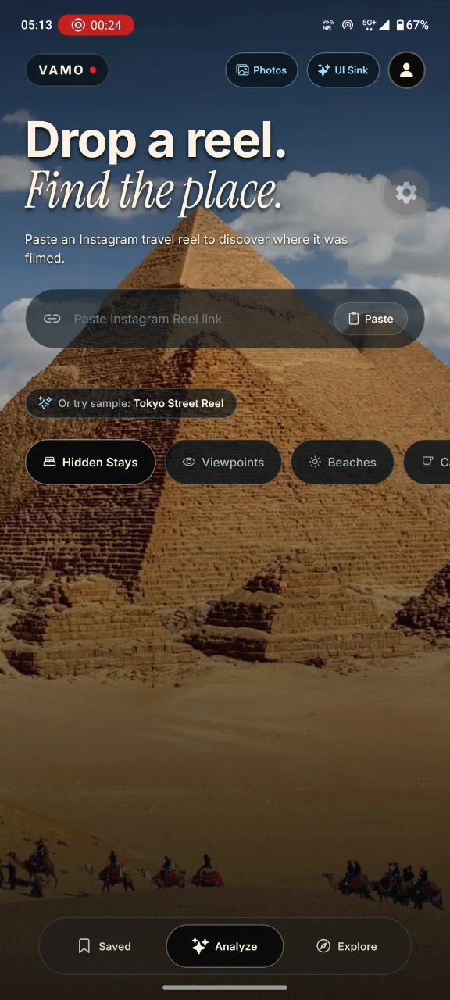
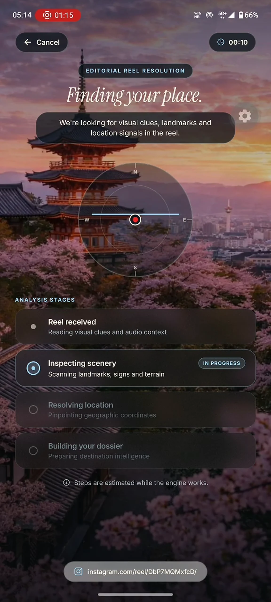
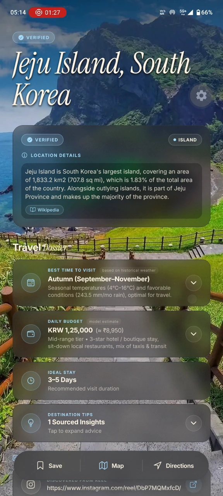
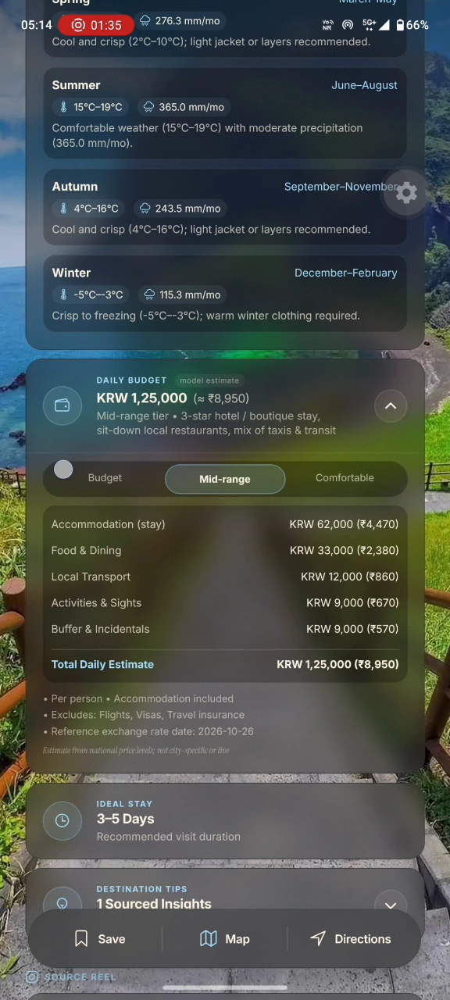
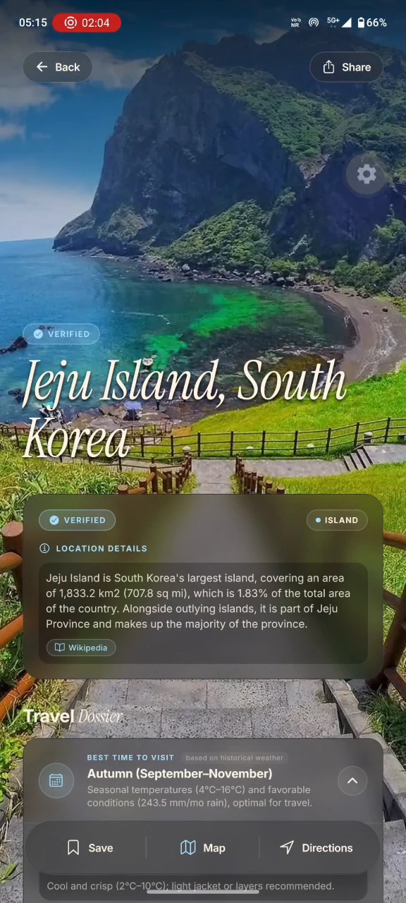
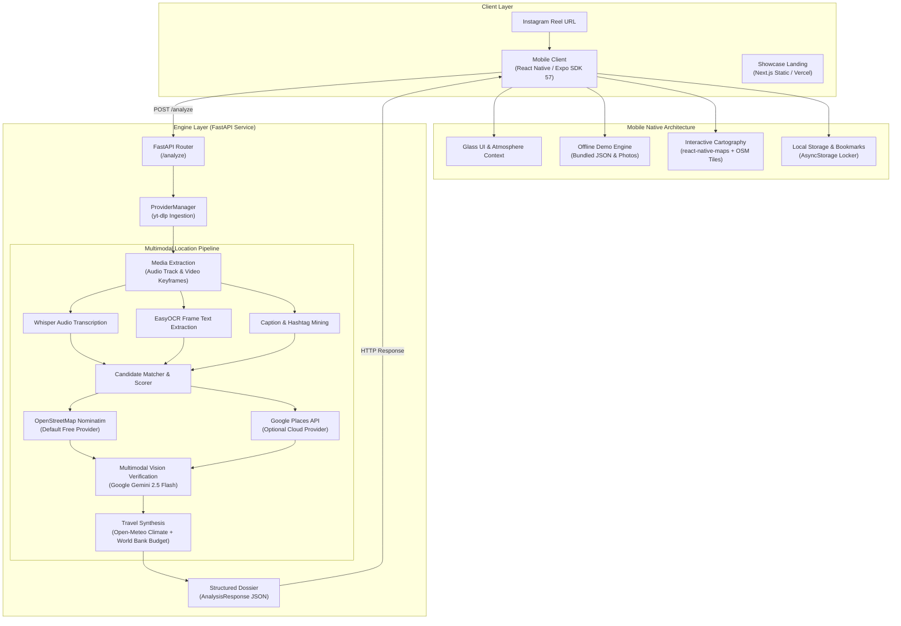

<div align="center">


# VAMO · Travel AI

### AI-powered travel discovery from social media video.

Turn short-form travel inspiration into verified real-world destinations, climate normals, transparent budget estimates, and interactive cartography.

<br />

[-amber.svg?style=for-the-badge)](https://github.com/pradnesh-deshmukh/travel-ai)
[](https://reactnative.dev)
[](https://expo.dev)
[](https://fastapi.tiangolo.com)
[](https://nextjs.org)
[](https://www.typescriptlang.org)
[](https://www.openstreetmap.org)

</div>

---

> [!NOTE]
> **Project Status: Active Working Prototype**  
> VAMO is an open-source prototype in active development. It is **not** currently published on the Apple App Store or Google Play Store. The showcase waitlist is open for early preview testing. All claims, data sources, and system capabilities below reflect the actual repository implementation.

---

## What is VAMO?

Travelers discover incredible destinations through short-form social video every day: a hidden cove in the Mediterranean, a quiet ramen shop in Kyoto, or an ancient alleyway in Rome. However, these videos are geographically opaque: creators omit coordinates, tag vague generic regions, and overlay background music that masks local audio clues.

**VAMO bridges social video inspiration and real-world travel.**

The project consists of three core components:
1. **Mobile Application (`mobile/`):** A high-performance native iOS & Android client built with **React Native (Expo SDK 57)** and TypeScript, featuring dark atmospheric glass aesthetics, gesture-driven bottom sheets, interactive OpenStreetMap cartography, and a 100% offline demo mode.
2. **Intelligence Engine (`engine/`):** A modular **FastAPI** backend that reverse-engineers public travel video links via audio speech transcription (Whisper), frame optical character recognition (OCR), geocoding candidate resolution (OpenStreetMap / Google Places), and multimodal landmark verification (Google Gemini).
3. **Showcase Landing Page (`landing/`):** A static **Next.js + Tailwind CSS** export built for free hosting on Vercel, featuring a 22-photo hero slideshow, embedded demo video, and a zero-backend waitlist.

---

## Product Screenshots

<div align="center">
  <table>
    <tr>
      <td align="center" width="20%">
        <br />
        <b>1. Analyze</b><br />
        <sub>Reel URL input & demo scenario chooser</sub>
      </td>
      <td align="center" width="20%">
        <br />
        <b>2. Processing</b><br />
        <sub>Multimodal extraction stages</sub>
      </td>
      <td align="center" width="20%">
        <br />
        <b>3. Results Dossier</b><br />
        <sub>Climate, budget & editorial overview</sub>
      </td>
      <td align="center" width="20%">
        <br />
        <b>4. Cartography</b><br />
        <sub>OpenStreetMap tiles & POI peek sheet</sub>
      </td>
      <td align="center" width="20%">
        <br />
        <b>5. Place Detail</b><br />
        <sub>Verified facts, elevation & directions</sub>
      </td>
    </tr>
  </table>
</div>

---

## System Architecture



---

## Running on Free Providers (Zero-Cost Setup)

The entire VAMO stack can run locally or on free cloud tiers without mandatory paid subscriptions.

### 1. Intelligence Engine (`engine/`)

You can run the backend engine with **zero paid API keys** by using the OpenStreetMap (OSM) provider:

#### Local Execution:
```bash
# 1. Enter the engine directory
cd engine

# 2. Create and activate a Python 3.11+ virtual environment
python -m venv .venv
# Windows (PowerShell):
.\.venv\Scripts\Activate.ps1
# macOS / Linux:
source .venv/bin/activate

# 3. Install dependencies
pip install -r requirements.txt

# 4. Create engine/.env with free provider configuration
# Note: APP_CONTACT must be a valid email for OSM Acceptable Use Policy compliance
echo "PLACES_PROVIDER=osm" >> .env
echo "APP_CONTACT=yourname@yourdomain.com" >> .env

# 5. Start the FastAPI engine
python -m uvicorn engine.app.main:app --reload --port 8000
```
- API health check: `http://127.0.0.1:8000/health`
- Interactive Swagger docs: `http://127.0.0.1:8000/docs`

#### Free Cloud Hosting Options:
- **Render / Fly.io / Railway / Hugging Face Spaces:** Deploy `engine/` as a Docker container or Python web service on their free tiers. Set environment variables `PLACES_PROVIDER=osm` and `APP_CONTACT=your-email@domain.com`.
- **Optional Cloud AI:** To enable Gemini vision verification, add `GEMINI_API_KEY` (available with free rate-limited tier from Google AI Studio).

---

### 2. Mobile Client (`mobile/`)

Run the mobile app on your own physical smartphone or desktop simulator via **Expo Go** (zero Apple/Google developer fees):

```bash
# 1. Enter the mobile directory
cd mobile

# 2. Install dependencies
npm install

# 3. Start the Expo development server
npm start
```
- **Physical Phone (iOS or Android):** Install the free **Expo Go** app from the App Store / Google Play, and scan the terminal QR code.
- **Simulator:** Press `i` for iOS Simulator or `a` for Android Emulator.

#### 100% Offline Demo Mode (Zero Network Required)
The mobile app includes a built-in offline demonstration engine:
1. Open the app and navigate to **Profile > About**.
2. Tap the **Version** row **5 times**.
3. A **Demo mode** status pill appears in the top navigation header.
4. On the **Analyze** tab, tap any of the 3 scenario chips (**Jeju Island**, **Rome**, **Kyoto**).
5. The app executes the full 6.0s multimodal processing animation and renders complete destination dossiers, OpenStreetMap cartography, and place details completely offline (works in airplane mode).
6. Enable **Recording Mode** in **Profile > Preferences** to suppress dev badges, logs, and toasts for clean presentations.

---

### 3. Showcase Landing Page (`landing/`)

The landing page is statically pre-rendered and deployable on the **Vercel Free Tier**:

```bash
# 1. Enter the landing directory
cd landing

# 2. Install dependencies
npm install

# 3. Run production asset verification and static build
npm run build
```

#### Deploy to Vercel (Free):
1. Import the repository at [vercel.com/new](https://vercel.com/new).
2. Set **Root Directory** to `landing`.
3. Set **Framework Preset** to `Next.js`.
4. Configure optional waitlist environment variables:
   - Formspree: `NEXT_PUBLIC_FORMSPREE_URL=https://formspree.io/f/your-form-id`
   - Or Google Forms: `NEXT_PUBLIC_GOOGLE_FORMS_URL` and `NEXT_PUBLIC_GOOGLE_FORMS_ENTRY_ID`
5. Click **Deploy**. Vercel will host the static export with global CDN distribution at zero cost.

---

## Data Sources & Licensing

VAMO strictly utilizes verified, open-access, and truthfully attributed data sources. No user ratings or review counts are fabricated.

| Dataset / Service | Provider | License / Terms | Application Usage |
| :--- | :--- | :--- | :--- |
| **Geocoding & POIs** | [OpenStreetMap](https://www.openstreetmap.org) via Nominatim & Overpass | [Open Data Commons Open Database License (ODbL)](https://opendatacommons.org/licenses/odbl/) | Landmark coordinates, boundary matching, nearby attractions, dining, and cafes. Attribution: `© OpenStreetMap contributors`. |
| **Map Tiles** | [OpenStreetMap Standard Tile Layer](https://operations.osmfoundation.org/policies/tiles/) | [ODbL](https://opendatacommons.org/licenses/odbl/) | Native slippy map tiles in mobile interactive cartography. |
| **Historical Climate Normals** | [Open-Meteo](https://open-meteo.com) Historical Weather API | [Creative Commons Attribution 4.0 International (CC BY 4.0)](https://creativecommons.org/licenses/by/4.0/) | 30-year monthly temperature normals, peak highs/lows, and precipitation days for seasonality guidance. |
| **Encyclopedic Facts** | [Wikidata](https://www.wikidata.org) Entity API | [Creative Commons CC0 1.0 Universal Public Domain Dedication](https://creativecommons.org/publicdomain/zero/1.0/) | Designated heritage status, official area, and verified elevation metrics. |
| **Price Ratios & Purchasing Power** | [World Bank](https://data.worldbank.org) International Comparison Program (ICP) | [World Bank Open Data Terms](https://www.worldbank.org/en/about/legal/terms-of-use-for-datasets) | Destination price level indices relative to US baseline used to calculate daily budget tiers. |
| **Place Imagery (Runtime)** | [Wikimedia Commons](https://commons.wikimedia.org) | Per-file Creative Commons licenses (CC BY-SA 4.0 / CC BY 3.0 / Public Domain) | Dynamic candidate illustration with author credit and license URI preservation. |
| **Demo Photography** | Original Photography | Proprietary bundle for demonstration | 22 authentic travel photographs bundled in mobile demo mode and landing hero slideshow. No synthetic Wikimedia credits applied. |

---

## Known Limitations

We believe in engineering honesty. The current prototype has the following documented constraints:

1. **No Fabricated Reviews:** Third-party review counts and numerical star ratings (e.g. "4.8 ★ (1,240 reviews)") are **hidden** in open-provider and demo modes because no compliant, zero-cost API offers them freely.
2. **Budget Estimates are Statistical:** Daily expenditure figures (Budget, Mid-Range, Luxury) are calculated estimates based on World Bank ICP purchasing-power ratios adjusted for local currency exchange rates. They are not live quotes from hotel reservation engines.
3. **OSM Nominatim Rate Limits:** In compliance with the OSM Foundation Acceptable Use Policy, geocoding requests are strictly throttled to 1 request per second with a valid contact User-Agent header. Bulk batch resolution requires an enterprise geocoding instance.
4. **Public Video Ingestion:** Social reel analysis depends on public availability of video URLs and `yt-dlp` extractor compatibility. Private accounts, DRM-protected media, and stories are unsupported.
5. **Offline Demo Scope:** 100% offline functionality is available for the 3 bundled reference destinations (Jeju Island, Rome, Kyoto). Analyzing arbitrary new reel URLs requires network connectivity and an active backend engine.

---

## Project Roadmap

- [x] **Phase 1: Core Multimodal Engine** — yt-dlp media extraction, Whisper speech transcription, EasyOCR frame text mining.
- [x] **Phase 2: Hybrid Provider Architecture** — OpenStreetMap Nominatim + Overpass provider alongside Google Places.
- [x] **Phase 3: Scientific Travel Intelligence** — Open-Meteo 30-year climate normals and World Bank ICP budget modeling.
- [x] **Phase 4: Mobile Glass UI & Cartography** — Dark editorial design tokens, interactive OSM tiles, peek sheets, and place detail modals.
- [x] **Phase 5: Offline Demo Engine** — Airplane-mode demonstration mode with real pre-fetched Wikidata, OSM, and Open-Meteo datasets.
- [x] **Phase 6: Showcase Landing & Asset Guard** — Next.js static landing page, 22-photo hero slideshow, asset verification guard, and waitlist integration.
- [ ] **Phase 7: Additional Platforms** — Support for TikTok and YouTube Shorts video ingestion.
- [ ] **Phase 8: Offline Vector Cartography** — Embedded MBTiles / MapLibre native vector tile rendering for fully offline regional map exploration.
- [ ] **Phase 9: Multi-Stop Day Planner** — Automated itinerary generation sequencing nearby POIs with walking transit intervals.

---

## Development & Verification

### Running Automated Test Suites

```bash
# 1. Engine Python Test Suite (Pytest)
cd engine
pytest tests/ -v

# 2. Mobile TypeScript Strict Check
cd mobile
npx tsc --noEmit

# 3. Landing Build & Static Export Check
cd landing
npm run build

# 4. Demo Data Source Verification Script
npx tsx scripts/verify-demo-scenarios.ts
```

---

<div align="center">

**VAMO** · *Drop a reel. Find the place.*  
Built with React Native, Expo, FastAPI, and OpenStreetMap.

</div>
